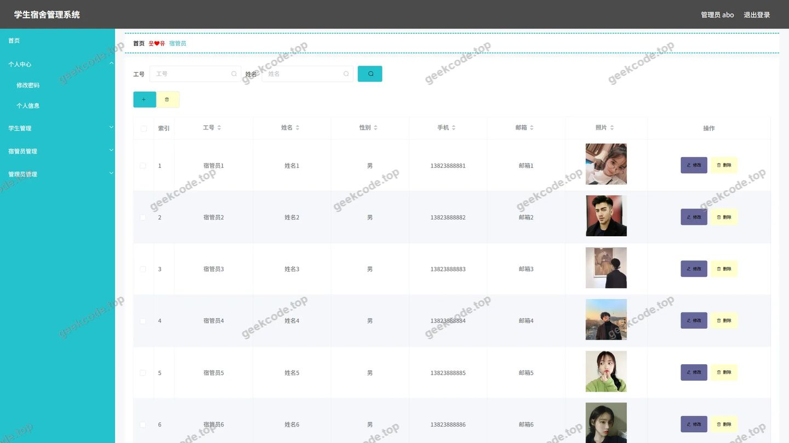
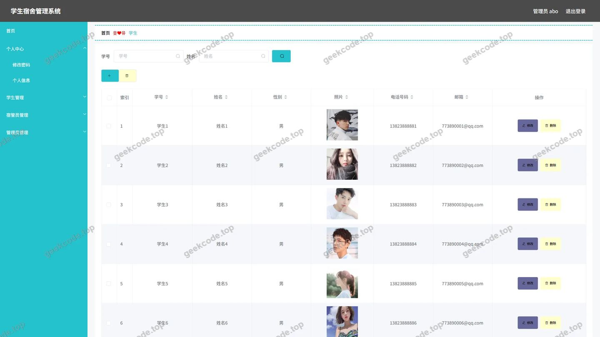
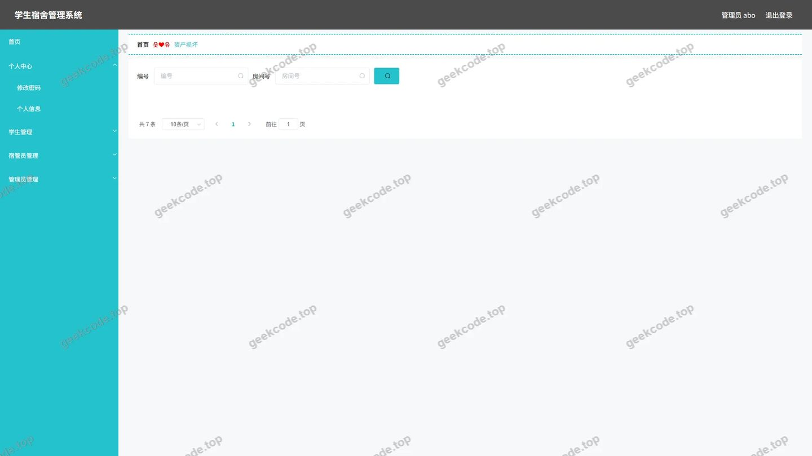
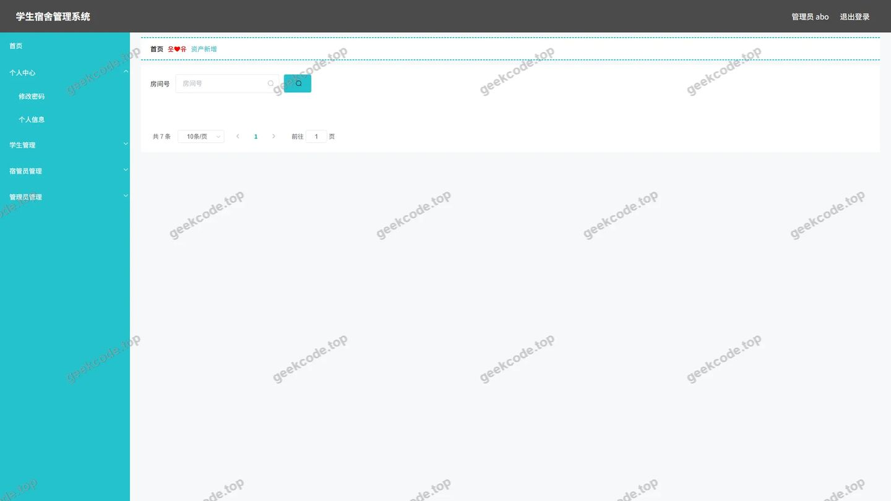

# 学生宿舍管理系统的设计与开发

> 🎓 **计算机毕业设计 · 学生宿舍管理系统的设计与开发**
>
> 本仓库只放**项目介绍 + 运行截图**（截图是站点带水印的原图，存在仓库 `images/` 里）。
>
> 👉 **完整可运行源码 / 数据库脚本 / 部署文档：[点我获取](https://geekcode.top/archives/%E5%AD%A6%E7%94%9F%E5%AE%BF%E8%88%8D%E7%AE%A1%E7%90%86%E7%B3%BB%E7%BB%9F%E7%9A%84%E8%AE%BE%E8%AE%A1%E4%B8%8E%E5%BC%80%E5%8F%91?utm_source=github)**
>
> 💬 咨询微信：**ir9372**　|　🌐 更多项目：[极客代码 geekcode.top](https://geekcode.top/?utm_source=github)
>
> 📌 项目详情页：<https://geekcode.top/archives/%E5%AD%A6%E7%94%9F%E5%AE%BF%E8%88%8D%E7%AE%A1%E7%90%86%E7%B3%BB%E7%BB%9F%E7%9A%84%E8%AE%BE%E8%AE%A1%E4%B8%8E%E5%BC%80%E5%8F%91?utm_source=github>

<table><td width="230" align="center"> <b>扫码加微信 ir9372</b></td><td valign="middle">📦 源码 = 项目介绍 + 全部运行截图 + 数据库 + 部署文档 👉 点上方任意截图，直接跳到 <b>极客代码 geekcode.top</b> 详情页</td></table>

---

<h1>学生宿舍管理系统的设计与开发</h1>
<h2>项目概述</h2>

本项目旨在构建一套高效、规范的学生宿舍管理系统，以解决传统高校宿舍管理中信息分散、资产登记繁琐及缴费记录不透明等痛点。系统核心功能涵盖学生信息管理、宿管员档案维护、宿舍床位分配、公寓资产管理（新增与损坏上报）、日常事务处理以及缴费信息记录。适用人群主要为高校后勤管理人员及宿舍管理员。技术架构上，后端采用 Spring Boot 框架结合 MyBatis-Plus 实现数据持久层操作，利用 Shiro 进行安全权限控制，前端基于 Vue 框架构建管理界面，实现了前后端分离的现代化开发模式，确保系统的高可用性与易维护性。

<h2>技术架构</h2>

本系统采用经典的前后端分离架构设计。后端服务基于 Java 语言，使用 Spring Boot 作为核心框架，通过 <code>spring-boot-starter-web</code>提供 RESTful API 接口支持。数据访问层选用 MyBatis-Plus，配合 <code>mysql-connector-java</code>驱动连接 MySQL 数据库，利用其强大的代码生成器和条件构造器简化 CRUD 操作。安全层面集成 Apache Shiro (<code>shiro-spring</code>)，负责用户认证与会话管理，确保只有授权用户才能访问后台敏感数据。

前端部分基于 Vue 框架搭建管理控制台，通过路由配置实现模块化页面跳转。数据库设计遵循第三范式，主要实体包括学生、宿管员、公寓资产、缴费信息等，通过外键关联保证数据一致性。技术选型理由在于 Spring Boot 的快速启动特性适合毕设周期，MyBatis-Plus 提升了开发效率，而 Shiro 提供了成熟且轻量级的权限解决方案，符合中小型管理系统的性能与安全需求。

<h2>功能模块</h2>

根据后台路由配置及截图显示，系统仅包含后台管理端功能，无独立前台用户界面。主要功能模块如下：

<ol>
<li><strong>基础信息管理</strong></li>
</ol>
<ul>
<li><strong>学生管理 (<code>/xuesheng</code>, <code>/xueshengxinxi</code>)</strong>：录入、查询、修改和删除学生基本信息，包括姓名、学号、联系方式等。</li>
<li><strong>宿管员管理 (<code>/suguanyuan</code>)</strong>：维护宿舍管理员的账号信息及管辖范围。</li>
<li><strong>用户管理 (<code>/users</code>)</strong>：管理系统登录用户账户，支持增删改查。</li>
</ul>
<ol start="2">
<li><strong>宿舍资源管理</strong></li>
</ol>
<ul>
<li><strong>床位安排 (<code>/chuangweianpai</code>)</strong>：对宿舍床位进行分配与管理，记录入住状态。</li>
<li><strong>公寓资产管理 (<code>/gongyuzichan</code>, <code>/zichansunhuai</code>, <code>/zichanxinzeng</code>)</strong>：登记公寓内的固定资产，支持资产新增录入以及资产损坏情况的记录与上报。</li>
</ul>
<ol start="3">
<li><strong>业务事务管理</strong></li>
</ol>
<ul>
<li><strong>缴费信息管理 (<code>/jiaofeixinxi</code>)</strong>：记录学生的住宿费及其他相关费用的缴纳情况。</li>
<li><strong>日常事物管理 (<code>/richangshiwu</code>)</strong>：处理宿舍日常运营中的各类事务记录，如卫生检查、维修申请等。</li>
<li><strong>公共厕所清理管理 (<code>/qingligonggongchangsuo</code>)</strong>：专门针对公共区域卫生清理任务的调度与记录。</li>
</ul>
<ol start="4">
<li><strong>系统支撑模块</strong></li>
</ol>
<ul>
<li><strong>文件服务 (<code>FileController</code>)</strong>：提供图片上传、下载及静态资源管理服务。</li>
<li><strong>通用配置 (<code>CommonController</code>, <code>ConfigController</code>)</strong>：处理系统参数配置及通用业务逻辑。</li>
</ul>
<h2>用户角色与权限</h2>

基于 Shiro 安全框架及截图显示的 &quot;admin&quot; 标识，系统主要划分为管理员角色。由于未提供普通用户或学生角色的具体路由访问权限细节，以下描述基于现有可见功能模块：

<ul>
<li>
<strong>超级管理员 (Admin)</strong>

</li>
<li>
<strong>权限范围</strong>：拥有系统最高权限，可访问所有后台路由。

</li>
<li>
<strong>可访问模块</strong>：

</li>
<li>
学生信息管理：查看、编辑、删除学生数据。

</li>
<li>
宿管员管理：维护管理员账号。

</li>
<li>
资产全生命周期管理：执行资产新增、查看资产列表、记录资产损坏。

</li>
<li>
财务与事务：管理缴费信息、处理日常事物、安排公共厕所清理任务。

</li>
<li>
系统配置：管理用户账户 (<code>/users</code>) 及系统基础配置。

</li>
<li>
床位管理：执行床位分配操作。

</li>
<li>
<strong>其他角色</strong>

</li>
<li>
根据现有信息无法确定是否存在受限角色（如普通宿管员或只读用户）。当前上下文仅展示了 admin 视角下的完整功能列表。

</li>
</ul>
<h2>项目特色与创新点</h2>
<ol>
<li><strong>精细化资产闭环管理</strong>：不同于常规系统仅记录资产存在，本项目特别设计了“资产新增”与“资产损坏”双模块，形成了从入库到损耗的完整追踪链条，有助于高校后勤部门准确掌握设施折旧与维修成本。</li>
<li><strong>专项卫生管理模块</strong>：引入“清理公共厕所”专属路由，体现了对宿舍公共卫生细节的关注，将非结构化的人工清洁任务转化为数字化记录，便于考核与追溯。</li>
<li><strong>高内聚低耦合的后端设计</strong>：通过 Controller 层的清晰划分（如将 <code>Xuesheng</code> 与 <code>Xueshengxinxi</code> 分离，可能分别对应基础身份信息与详细扩展信息），优化了数据查询效率，避免了单一表字段冗余导致的性能瓶颈。</li>
<li><strong>安全性保障</strong>：集成 Shiro 框架，相比传统的 Session 验证，提供了更细粒度的权限控制和会话管理，有效防止越权访问，保障了学生隐私数据（如联系方式、缴费记录）的安全性。</li>
</ol>
<h2>部署环境</h2>

为确保系统正常运行，需准备以下软件环境：

<ul>
<li><strong>操作系统</strong>：Windows 10/11, Linux (CentOS 7+, Ubuntu 20.04+) 或 macOS。</li>
<li><strong>Java 运行环境</strong>：JDK 1.8 及以上版本（推荐 JDK 1.8，兼容性好）。</li>
<li><strong>数据库</strong>：MySQL 5.7 或 MySQL 8.0 社区版。</li>
<li><strong>构建工具</strong>：Maven 3.6+ 用于后端依赖管理与打包。</li>
<li><strong>前端环境</strong>：Node.js 14+ 及 npm/yarn，用于编译 Vue 前端代码。</li>
<li><strong>Web 服务器</strong>：内置 Tomcat（由 Spring Boot 自动集成）或 Nginx（用于生产环境反向代理及静态资源托管）。</li>
<li><strong>开发工具</strong>：IntelliJ IDEA 或 Eclipse（后端开发），VS Code（前端开发）。</li>
</ul>
<h2>五、技术特性</h2>
<ul>
<li>前后端集成部署，前端资源打包至后端 static 目录</li>
<li>使用 MyBatis-Plus 简化数据访问层开发</li>
<li>集成 Shiro 权限框架实现角色权限控制</li>
</ul>
<h2>六、功能模块截图</h2>
<h3>后台管理端</h3>
<h4>后台-登录页</h4>

<h4>后台-缴费信息</h4>

<h4>后台-日常事物</h4>

<h4>后台-宿管员</h4>

<h4>后台-学生</h4>

<h4>后台-资产损坏</h4>

<h4>后台-资产新增</h4>

---

## 获取完整源码

| 项目 | 说明 |
| --- | --- |
| 项目名 | 学生宿舍管理系统的设计与开发 |
| 运行截图 | 本文 7 张（站点带水印原图，仓库 `images/` 目录） |
| 完整源码 | [https://geekcode.top/archives/%E5%AD%A6%E7%94%9F%E5%AE%BF%E8%88%8D%E7%AE%A1%E7%90%86%E7%B3%BB%E7%BB%9F%E7%9A%84%E8%AE%BE%E8%AE%A1%E4%B8%8E%E5%BC%80%E5%8F%91?utm_source=github](https://geekcode.top/archives/%E5%AD%A6%E7%94%9F%E5%AE%BF%E8%88%8D%E7%AE%A1%E7%90%86%E7%B3%BB%E7%BB%9F%E7%9A%84%E8%AE%BE%E8%AE%A1%E4%B8%8E%E5%BC%80%E5%8F%91?utm_source=github) |
| 咨询微信 | **ir9372**（备注：jingpin-yuanma） |
| 更多项目 | [极客代码 geekcode.top](https://geekcode.top/?utm_source=github) |

> 需要源码、部署、改配置、跑不起来等问题，加微信 ir9372 沟通，说明项目名即可。
